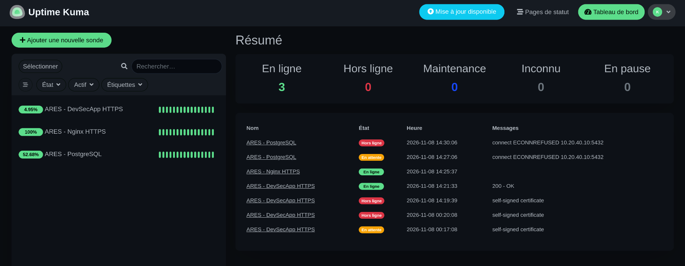
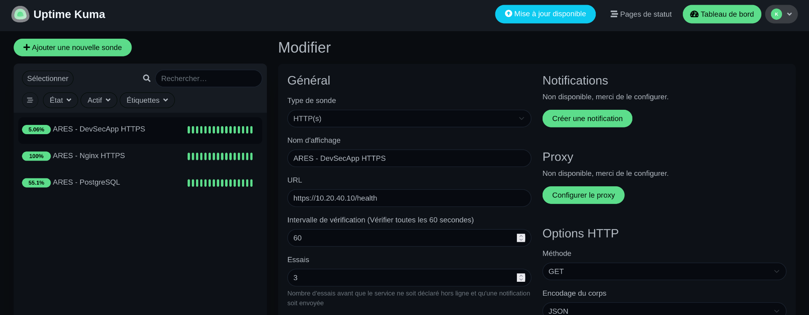
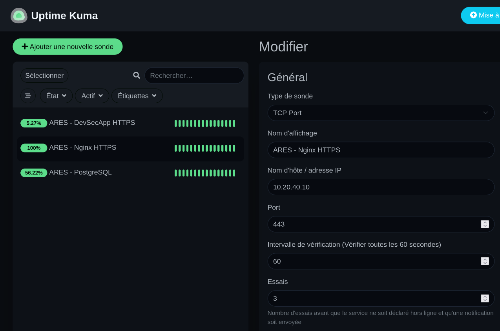
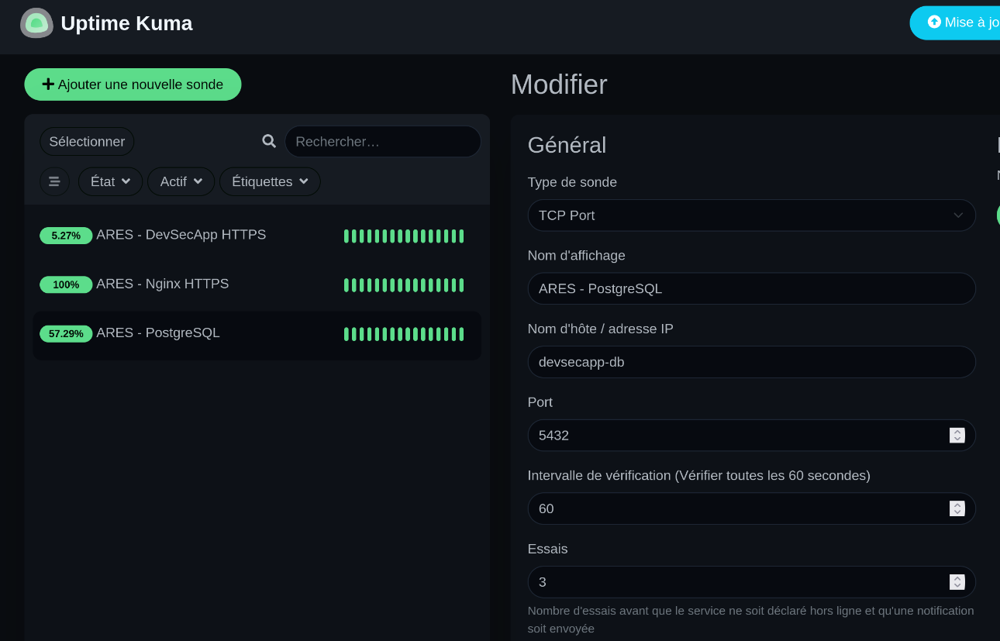

# Supervision et monitoring — ARES

## 1. Présentation

Dans le cadre du projet ARES (*Automated Resilient Enterprise Security*), une solution de supervision a été déployée afin de surveiller la disponibilité des principaux services de la plateforme.

La solution retenue est **Uptime Kuma**, un outil open source de supervision permettant de contrôler périodiquement la disponibilité de services HTTP(S) et de ports TCP.

L'objectif est de détecter rapidement une indisponibilité de l'application DevSecApp, de son serveur web Nginx ou de sa base de données PostgreSQL.

### Objectifs

- Surveiller la disponibilité des services critiques.
- Détecter les interruptions de service.
- Vérifier le fonctionnement de l'application depuis son endpoint de santé.
- Contrôler l'accessibilité des services réseau.
- Conserver les données de supervision après un redémarrage du conteneur.
- Limiter l'exposition réseau des composants sensibles.

## 2. Architecture de supervision

Uptime Kuma est déployé directement sur la VM applicative ARES, située dans le VLAN 40 — SERVERS.

| Élément | Configuration |
|---|---|
| Machine virtuelle | VM102 — ares-app-vlan40 |
| Adresse IP | 10.20.40.10 |
| Solution | Uptime Kuma |
| Déploiement | Docker Compose |
| Image Docker | louislam/uptime-kuma:1 |
| Port d'accès | TCP 3001 |
| Stockage | Volume Docker persistant |
| Réseau Docker | devsecapp_default |

L'interface web est accessible à l'adresse :

`http://10.20.40.10:3001`

### Tableau de bord



Le tableau de bord centralise les trois contrôles de disponibilité configurés pour l'infrastructure ARES.

## 3. Déploiement Docker

Uptime Kuma est installé dans le répertoire `/opt/uptime-kuma` sur la VM102.

Le déploiement repose sur le fichier `compose.yml` suivant :

```yaml
services:
  uptime-kuma:
    image: louislam/uptime-kuma:1
    container_name: uptime-kuma
    restart: unless-stopped
    ports:
      - "10.20.40.10:3001:3001"
    volumes:
      - uptime_kuma_data:/app/data
    networks:
      - devsecapp_monitoring
    logging:
      driver: json-file
      options:
        max-size: "10m"
        max-file: "3"

volumes:
  uptime_kuma_data:

networks:
  devsecapp_monitoring:
    external: true
    name: devsecapp_default
```

### Choix techniques

- `restart: unless-stopped` : redémarrage automatique du service après un redémarrage de Docker ou de la machine.
- `ports` : publication de l'interface uniquement sur l'adresse IP de la VM applicative.
- `uptime_kuma_data` : conservation des données de supervision dans un volume Docker persistant.
- `devsecapp_default` : connexion au réseau Docker existant de DevSecApp.
- `logging` : limitation de la taille et du nombre de fichiers de journaux.

Le réseau Docker est déclaré comme externe afin de permettre à Uptime Kuma de communiquer avec les conteneurs de DevSecApp sans modifier leur configuration réseau.

## 4. Configuration des moniteurs

Trois moniteurs ont été configurés afin de couvrir les composants essentiels de l'application.

### 4.1 DevSecApp — Supervision HTTPS

**Type de contrôle :** HTTP(s)

| Paramètre | Valeur |
|---|---|
| Nom | ARES - DevSecApp HTTPS |
| URL | https://10.20.40.10/health |
| Intervalle | 60 secondes |
| Vérification | Endpoint de santé HTTP |
| Certificat TLS | Erreur de validation ignorée |

Ce contrôle interroge directement l'endpoint `/health` de l'application DevSecApp.

Il permet de vérifier que l'application répond correctement aux requêtes HTTP(S).

Le certificat TLS étant autosigné, l'option d'ignorance des erreurs de validation du certificat est activée dans Uptime Kuma. La connexion reste chiffrée, mais l'identité du certificat n'est pas vérifiée par cette sonde.



### 4.2 Nginx — Supervision HTTPS

**Type de contrôle :** TCP Port

| Paramètre | Valeur |
|---|---|
| Nom | ARES - Nginx HTTPS |
| Hôte | 10.20.40.10 |
| Port | 443 |
| Intervalle | 60 secondes |
| Tentatives | 3 |

Ce moniteur vérifie que le port TCP 443 est accessible sur la machine applicative.

Il permet de détecter une indisponibilité du service Nginx ou une interruption de son écoute réseau.

Ce contrôle est complémentaire à celui de DevSecApp : il vérifie l'accessibilité du port, sans valider à lui seul le contenu de la réponse HTTPS.



### 4.3 PostgreSQL — Supervision de la base de données

**Type de contrôle :** TCP Port

| Paramètre | Valeur |
|---|---|
| Nom | ARES - PostgreSQL |
| Hôte | devsecapp-db |
| Port | 5432 |
| Intervalle | 60 secondes |
| Tentatives | 3 |

Ce moniteur vérifie l'accessibilité du port TCP 5432 de PostgreSQL depuis le réseau Docker interne. Il confirme que le service accepte les connexions TCP, sans vérifier l'authentification ni l'exécution de requêtes SQL.

Le nom `devsecapp-db` correspond au nom du conteneur PostgreSQL. La résolution de ce nom est assurée par le DNS interne de Docker.

**Choix de sécurité :**

Le port PostgreSQL 5432 n'est pas publié sur l'adresse IP de la VM et n'est donc pas directement accessible depuis les VLAN de l'infrastructure.

Uptime Kuma accède à la base de données par le réseau Docker partagé `devsecapp_default`.

Cette architecture permet de superviser PostgreSQL sans créer de règle d'exposition réseau supplémentaire.



## 5. Sécurité et segmentation réseau

La configuration de la supervision respecte le principe de réduction de la surface d'exposition.

Les mesures suivantes ont été appliquées :

- L'interface Uptime Kuma est publiée sur l'adresse de la VM applicative, sur le port TCP 3001.
- Le conteneur Uptime Kuma rejoint le réseau Docker privé `devsecapp_default`.
- La base PostgreSQL n'expose aucun port sur l'hôte.
- La communication avec PostgreSQL utilise le DNS interne Docker.
- Aucun accès direct depuis les VLAN utilisateurs à la base de données n'est nécessaire pour assurer la supervision.

Cette approche permet de conserver la séparation entre les services applicatifs et les réseaux utilisateurs.

## 6. Journalisation et persistance

### 6.1 Rotation des journaux Docker

Une politique de rotation a été configurée pour éviter une croissance illimitée des journaux du conteneur Uptime Kuma.

| Paramètre | Valeur |
|---|---|
| Driver | json-file |
| Taille maximale | 10 Mo |
| Nombre maximal de fichiers | 3 |

Cette configuration limite l'espace disque consommé par les journaux Docker.

### 6.2 Persistance des données

Les données d'Uptime Kuma sont stockées dans le volume Docker :

`uptime-kuma_uptime_kuma_data`

Le volume conserve notamment la configuration de l'application et les paramètres des moniteurs indépendamment du cycle de vie du conteneur.

## 7. Validation et tests

Plusieurs vérifications ont été réalisées après le déploiement.

| Vérification | Résultat attendu | Résultat obtenu |
|---|---|---|
| Conteneur Uptime Kuma | Running / Healthy | Conforme |
| Interface web | Accessible sur TCP 3001 | Conforme |
| DevSecApp HTTPS | UP | UP |
| Nginx HTTPS | UP | UP |
| PostgreSQL TCP 5432 | UP | UP |
| Résolution DNS Docker | devsecapp-db résolu | Conforme |
| Accès PostgreSQL interne | Port 5432 accessible | Conforme |
| Exposition PostgreSQL sur l'hôte | Aucune | Conforme |
| Volume persistant | Présent | Conforme |
| Rotation des journaux | 10 Mo / 3 fichiers | Conforme |

La communication avec PostgreSQL a notamment été testée depuis un conteneur temporaire connecté au réseau Docker de DevSecApp :

```bash
docker run --rm \
  --network devsecapp_default \
  postgres:17 \
  pg_isready -h devsecapp-db -p 5432
```

Résultat obtenu :

```text
devsecapp-db:5432 - accepting connections
```

Ce test confirme que PostgreSQL est joignable depuis le réseau Docker interne, sans publication de son port sur l'hôte.

## 8. Conclusion

Le déploiement d'Uptime Kuma apporte une visibilité sur la disponibilité des composants essentiels de la plateforme ARES.

Les trois moniteurs permettent de surveiller l'application DevSecApp, le serveur web Nginx et la base de données PostgreSQL.

La solution a été intégrée à l'architecture existante en conservant les principes de segmentation réseau et de limitation de l'exposition des services.

Les trois sondes ont été validées et sont opérationnelles.
